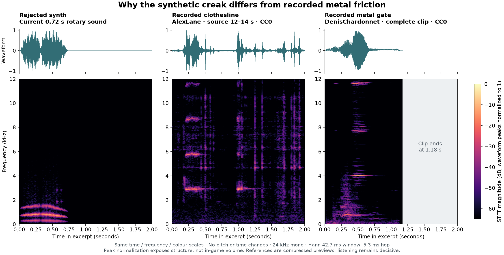

# Rotary creak reference study

2026-10-12. Jeremy rejected both synthesized rotary sounds. His request:

> lol no, that doesn't work at all. See if you can find reference audio somewhere and do a spectogram to see

This is a reference study, not a replacement game sound. No listening approval is implied. The game sound
at `608e0408` is retained as `rejected-synth.wav` so further work has an honest comparison.

## Recordings and provenance

- **Clothesline metallic squeak — AlexLane**, Freesound sound 530036, published 2020-08-07.
  [Source and CC0 declaration](https://freesound.org/people/AlexLane/sounds/530036/).
  The author describes an apartment clothesline reeled at different speeds; this is not identified as a rotary.
  Analysis used its public [HQ MP3 preview](https://cdn.freesound.org/previews/530/530036_2617886-hq.mp3),
  88.7785 s, 48 kHz mono. The original listed WAV is 96 kHz / 24 bit; it was not downloaded.
  `clothesline-excerpt.wav` is seconds 12–14, decoded to 24 kHz mono PCM, with no gain, pitch or speed change.
- **Grincement de portail en métal #2 — DenisChardonnet**, LaSonotheque sound 304.
  [Source and CC0 declaration](https://lasonotheque.org/grincement-de-portail-en-metal-2-s0304.html).
  `gate-0304.mp3` is the complete public [MP3 recording](https://lasonotheque.org/UPLOAD/mp3/0304.mp3),
  1.1755 s. The source describes metal-gate creaking recorded in studio.

Both pages declared CC0 when accessed 2026-10-12. These files are analysis references, not imported runtime assets.

SHA-256:

| File | Hash |
| --- | --- |
| Full clothesline HQ MP3 (downloaded to scratch) | `db3a792b5c72eb5d76b101bdb693c70213c6e14c73062ff3a1c3a6e737b6736e` |
| `clothesline-excerpt.wav` | `9af0487085fa93801a43302f261bbfcb70b88e09eb5b1bd479a62731361ba042` |
| `gate-0304.mp3` | `1126b280fb081ecd692eec98d5ce42d4bc92fd2f2e224f148e36ea830b251f38` |
| `rejected-synth.wav` | `d774d189bf84eef6a66f26c0bfcfc69ca03930e3480c1c16e0cda4e45176da1f` |

## Comparison



All analysis is 24 kHz mono, Hann-window STFT, 1024-sample window (42.67 ms), 128-sample hop (5.33 ms).
Each waveform is peak-normalized independently. Axes and colour scales are identical: 0–2 s, 0–12 kHz,
−65 to 0 dB STFT magnitude relative to normalized waveform peak. This compares structure, not recording gain
or perceived loudness. Mono decoding uses FFmpeg's default channel mix; stereo source peaks therefore differ
from the earlier per-channel game render checks. Previews are lossy, so do not infer precise physical modes
from compression noise. The displayed clothesline excerpt was selected after inspecting several passages,
including 1–3, 27–29 and 83–85 s, which also show bursts and persistent higher bands.

Measurements over each entire decoded clip, including silence (power-summed STFT, DC excluded):

| Sound | Energy above 2 kHz | Spectral centroid | 95% of energy below |
| --- | ---: | ---: | ---: |
| Rejected synth | 0.064% | 813 Hz | 1,453 Hz |
| Clothesline excerpt | 98.79% | 4,103 Hz | 8,648 Hz |
| Metal gate | 83.59% | 6,364 Hz | 11,672 Hz |

The synth concentrates almost everything into three smoothly arcing low bands. Its upper scrape/rattle barely
contributes. The clothesline has separated noisy attacks and ringing bands near 2.8, 5.8 and 8.7 kHz. Some stay
at nearly the same pitch while their excitation changes or stops. The gate grows through rougher friction into
strong narrow bands, including around 4 and 11.6 kHz. This is not a universal spectrum for metal; these two
specific recordings expose what our particular synthesis omitted.

**Design inference:** the next study should model intermittent excitation and ringing friction, with less
shared pitch wobble and substantially more upper-frequency character. Do not simply pitch the current note
up or match the energy percentage. A clothesline's near-2.8 kHz band and its independent attack/tail behaviour
are a useful starting reference; the gate is a contrasting example. Listening decides whether either character
fits the scene before further in-game tuning. Passing routing, cleanup and level checks does not establish timbre.

`*-audition.wav` files have matching −18 dBFS peaks, 250 ms lead-in and 350 ms trailing silence; this is not a
perceptual loudness match or the game mix. No equalization, pitch shift or time stretch is applied.

Reproduce the plot, measurements and auditions from the checked-in source clips:

```sh
uv run --with numpy --with scipy --with matplotlib python tools/creak-reference-study.py assets/audio-reference/rotary-creak
```

Tool versions used: SciPy 1.18.1, Matplotlib 3.11.2. Machine-readable measurements are in `measurements.json`.

After Jeremy approved proceeding, two short takes from the clothesline excerpt were prepared for playback.
[Runtime asset provenance and processing](../../audio/rotary-creak/README.md) records the exact cuts and
reproduction command; the game does not import the full study recordings or figures.
